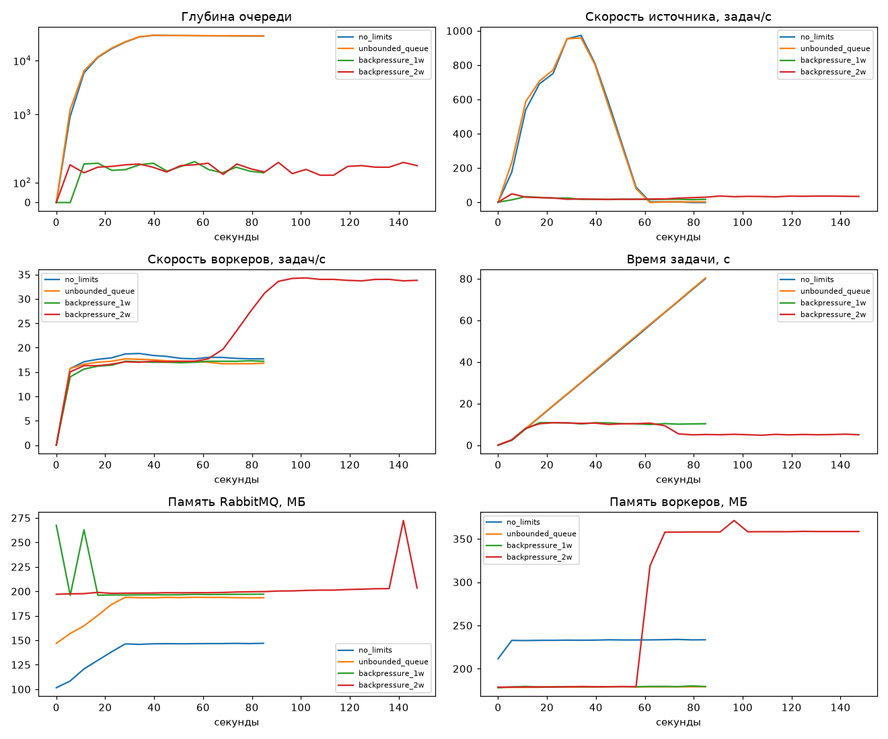

# Credit Scoring MLOps Service

Сервис прогноза дефолта по кредитной карте: FastAPI, модель из MLflow Model Registry и конвейер пакетного скоринга на FastStream и RabbitMQ с противодавлением.

Данные: [UCI Default of Credit Card Clients](https://archive.ics.uci.edu/dataset/350/default+of+credit+card+clients), 30 000 клиентов, 22 признака, доля дефолтов 22%. Пол из признаков исключён.

## Запуск

Нужны Docker и [uv](https://docs.astral.sh/uv/). Настройки по умолчанию работают без `.env`; порты и пароли меняются по образцу `.env.example`.

```bash
uv sync --group train
docker compose up -d --wait mlflow

uv run --group train python -m training.eda
uv run --group train python -m training.train
uv run --group train python -m training.promote

docker compose up -d --build --wait
```

| Что | Адрес |
|---|---|
| API и Swagger | http://localhost:8000/docs |
| MLflow UI | http://localhost:5001 |
| RabbitMQ Management (guest / guest) | http://localhost:15672 |

Тесты и проверки:

```bash
uv run pytest --cov
uv run pytest -m "not integration"
uv run pre-commit install
uv run pre-commit run --all-files
```

Интеграционным тестам нужен Docker. На Docker Desktop, если не стартует Ryuk, задайте `TESTCONTAINERS_RYUK_DISABLED=true`.

## Эндпоинты

| Метод и путь | Назначение |
|---|---|
| `GET /healthz` | liveness: процесс отвечает. Без версии API, потому что контракт с инфраструктурой не версионируется |
| `GET /api/v1/version` | версия из метаданных пакета (единый источник — `pyproject.toml`) и git SHA сборки |
| `GET /api/v1/health` | end-to-end: версии и время ответа PostgreSQL, RabbitMQ, MLflow; текущая модель. При отказе компонента — 503 |
| `POST /process` | синхронный inference моделью, загруженной при старте; в ответе версия модели |
| `POST /api/v1/tasks` | постановка задачи в очередь: 202 или сразу 503 с `Retry-After` |
| `GET /api/v1/tasks/{id}` | статус и результат задачи |

## Структура

```text
src/credit_scoring/
├── main.py            # приложение, lifespan, логирование запросов
├── config.py          # настройки из окружения
├── database.py        # asyncpg, идемпотентная запись результата
├── broker.py          # топология RabbitMQ, публикация с подтверждением
├── api/               # эндпоинты и проверки компонентов
├── ml/                # загрузка модели по alias, признаки
└── pipeline/          # worker.py и source.py — независимые процессы
training/              # EDA, обучение, назначение alias
experiments/           # нагрузочный эксперимент и проверки надёжности
docker/                # образ MLflow, конфиг RabbitMQ
.github/workflows/     # CI и CD
```

## CI/CD

- **CI** (`ci.yml`) на pull request и push в `main`: `ruff check`, `ruff format --check`, тесты с интеграционными, coverage не ниже 75%. Любая ошибка роняет pipeline.
- **CD** (`cd.yml`) публикует образ в GHCR:
  - push в `main` после успешного CI → `sha-<commit>` и `main`: каждый проверенный коммит можно развернуть и откатить;
  - тег `vX.Y.Z` → `X.Y.Z`, `X.Y`, `latest`: тег обязан совпасть с версией в `pyproject.toml`, поэтому `/api/v1/version` не расходится с образом;
  - pull request образ не публикует: чужой код не должен попадать в реестр.

Образ многоэтапный, запускается не от root; слой зависимостей кэшируется отдельно от кода. Версия читается из метаданных установленного пакета, поэтому пакет ставится в образ, а не только зависимости.

## MLflow

Tracking Server с отдельными хранилищами: Backend Store — PostgreSQL (эксперименты, параметры, метрики, реестр), Artifact Store — S3 на RustFS (файлы и модели). Клиенты работают с артефактами через сервер (`--serve-artifacts`), поэтому ключи S3 им не нужны.

Основная метрика — ROC-AUC: классы несбалансированы, а порог решения зависит от бизнеса. Дополнительные: PR-AUC, F1, precision, recall, Brier. Модель выбирается по валидации, тест нужен для итоговой оценки. Порог подбирается по F1 на валидации и хранится в теге версии модели.

| Версия | Run | val ROC-AUC | test ROC-AUC | test F1 |
|---|---|---|---|---|
| 1 | baseline-logreg | 0.7024 | 0.7242 | 0.5149 |
| 2 | logreg-features-balanced | 0.7425 | 0.7617 | 0.5369 |
| 3 | xgboost-default | 0.7516 | 0.7683 | 0.5260 |
| 4 (`champion`) | xgboost-tuned-features | 0.7772 | 0.7907 | 0.5554 |

Смена версии без правок кода:

```bash
uv run --group train python -m training.promote --version 2
docker compose restart app worker
```

До перезапуска сервис продолжает работать старой версией, потому что модель загружается один раз при старте.

## Конвейер и противодавление

```text
source ──publisher confirms──▶ quorum-очередь (200) ──prefetch=4──▶ worker (4 потока) ──▶ PostgreSQL
POST /api/v1/tasks ──────────▶        │ после 3 повторных доставок
   полна очередь → сразу 503          ▼
                                     DLQ
```

| Решение | Значение | Почему |
|---|---|---|
| Брокер → воркер | `prefetch_count = WORKER_CONCURRENCY = 4` | В воркере не бывает сообщений, которые ждут свободный поток и занимают память. Простой из-за подтверждения мал: задержка сети намного меньше времени inference (0.2 с). При падении повторно доставляются максимум 4 сообщения |
| Без блокировки event loop | `run_in_executor` с пулом на 4 потока | На стенде `/healthz` воркера отвечал за десятки миллисекунд при полной загрузке |
| Воркер → источник | `x-overflow: reject-publish` + publisher confirms | Сигнал приходит от самого брокера на каждое сообщение |
| Реакция источника | экспоненциальная задержка 0.05–2 с с jitter | Нет busy loop. Файл читается лениво, поэтому в памяти одна задача |
| Подтверждение | `AckPolicy.NACK_ON_ERROR` | ack только после записи в БД |
| Повторы | `x-delivery-limit: 3`, затем DLQ | Счётчик ведёт брокер, он сохраняется при падении воркера. Поэтому очередь quorum |
| Идемпотентность | `PRIMARY KEY (task_id)` и `ON CONFLICT` | Гонка невозможна на уровне БД. `task_id` источника детерминирован (`uuid5(batch, номер)`) |

**Отвергнутые варианты.** Опрос глубины через Management API: данные отстают (мы видели задержку больше 3 секунд на новой очереди) и нужен отдельный канал. `drop-head`: теряет старые задачи. Фиксированный лимит частоты: это rate limiting, он не следует за реальной пропускной способностью. Memory alarm брокера: блокирует всех издателей узла, а не одну очередь.

**Отвергнутые ack-политики.** `ACK_FIRST` теряет задачу при падении воркера. `REJECT_ON_ERROR` отправляет в DLQ при первой же временной ошибке. `MANUAL` даёт то же самое ценой лишнего кода.

**Граница системы.** Внешнего клиента нельзя замедлить: можно только быстро отказать, поэтому `POST /api/v1/tasks` — это сброс нагрузки, а не противодавление. `INSERT` и публикация идут в одной транзакции, которая фиксируется только после confirm. При отказе брокера запись откатывается, поэтому `PENDING` не остаётся. Воркер не обгонит вставку: его `INSERT` по тому же ключу ждёт коммита.

`Retry-After` = длина очереди / пропускная способность одного воркера = 200 / (4 / 0.2) = 10 с. Очередь откроется раньше (см. ниже), но большая пауза не даёт всем клиентам вернуться одновременно.

### Особенности quorum-очереди

Обе измерены на стенде:

- **Лимит мягкий.** При `x-max-length=5` брокер принимает 6-е сообщение и отказывает с 7-го. Под нагрузкой пик глубины составил 205 при лимите 200.
- **Гистерезис.** После переполнения приём возобновляется только при падении длины до 80% лимита. При лимите 20 публикация прошла на глубине 16. Поэтому глубина ходит пилой между 160 и лимитом.

## Эксперимент

`uv run --group train python -m experiments.run_load` (нужен запущенный стенд). Условия: inference 0.2 с, 4 потока на воркер, лимит CPU воркера 1 ядро, источник ограничен 30 000 задач, замер каждые 3 с. Средние значения — по установившемуся участку. Сырые данные лежат в `experiments/results/`.



| Сценарий | Источник, задач/с | Воркеры, задач/с | Время задачи, с | Макс. глубина | Память воркеров, МБ | Рост памяти RabbitMQ, МБ |
|---|---|---|---|---|---|---|
| Без ограничений | до ~970, пока не кончились задачи | 18.0 | 54.9 и растёт до 80 | 29 335 | 234 | ~45 |
| Очередь без лимита, prefetch=4 | до ~960 | 17.1 | 55.3 и растёт до 80 | 29 452 | 179 | ~47 |
| Backpressure, 1 воркер | 16.7 | 17.1 | 10.3 | 205 | 180 | не растёт |
| Backpressure, до второго воркера | 17.2 | 17.1 | 10.3 | 201 | 179 | не растёт |
| Backpressure, 2 воркера | 34.4 | 33.9 | 5.1 | 201 | 358 (сумма) | не растёт |

Выводы:

1. Без ограничений источник быстрее воркера в десятки раз, и задачи копятся в брокере. Время задачи растёт линейно и остановилось на 80 с только потому, что у источника кончились задачи.
2. С противодавлением скорость источника сама совпала со скоростью воркера (16.7 и 17.1), хотя лимита частоты нигде нет.
3. Второй воркер удвоил пропускную способность и скорость источника (с 17 до 34 задач/с) и вдвое сократил время задачи, без правок кода. Глубина осталась у лимита: очередь работает как буфер.
4. Без prefetch воркер забирает всю очередь себе в память: 234 МБ против 179 МБ.
5. Память источника одинакова во всех сценариях (42 МБ): задачи не копятся в нём ни при каких условиях.

Ограничения замера: сообщения маленькие, поэтому абсолютный рост памяти скромный; важен характер роста, а не мегабайты. Базовая память брокера менялась от прогона к прогону, поэтому сравнивается рост внутри сценария. Теоретический максимум воркера 20 задач/с, реальный 17 из-за самого inference и записи в БД при лимите в одно ядро.

### Проверки надёжности

`uv run --group train python -m experiments.check_reliability`. Результат сохраняется в `experiments/results/reliability.json`.

| Проверка | Результат |
|---|---|
| SIGTERM воркеру под нагрузкой, 2 воркера, 600 задач | 600 строк DONE, 0 в DLQ, принятые сообщения дообработаны перед выходом |
| SIGKILL воркеру под нагрузкой, 600 задач | 600 строк DONE: задачи доставлены повторно, дублей нет |
| `/healthz` воркера во время inference | максимум 32–71 мс по прогонам, в работе 8 сообщений |
| Некорректное сообщение | попало в DLQ после исчерпания попыток |
| 260 запросов к API без воркеров | 201 принят, 59 получили 503 с `Retry-After: 10` (не дольше 8 мс), в БД 201 строка, в очереди 201 |

## Что можно улучшить

- Повторы идут сразу; для временных сбоев лучше задержка между ними через отдельную очередь.
- Транзакция держит соединение с БД на время публикации (не дольше 1 с). Transactional outbox убрал бы эту связь, но добавил бы фоновую доставку.
- Смена модели требует перезапуска. Для обновления без простоя нужны rolling update с readiness-пробой или blue-green.
